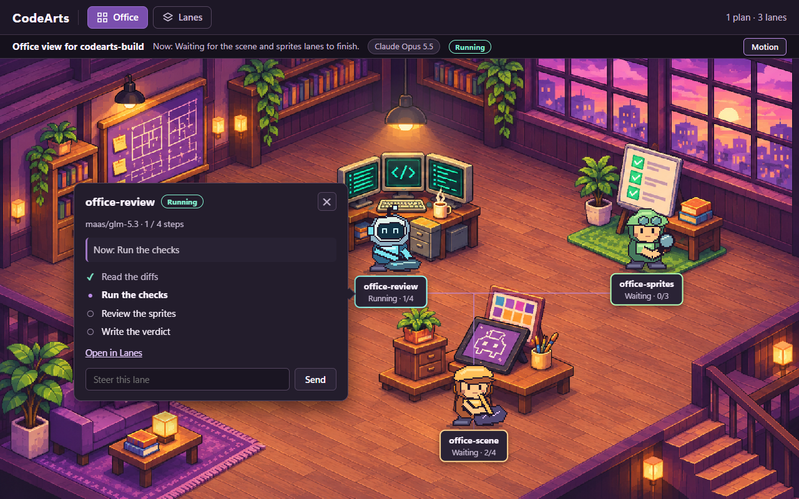
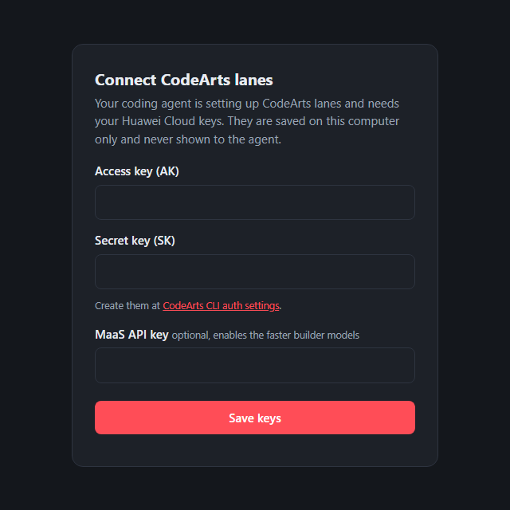
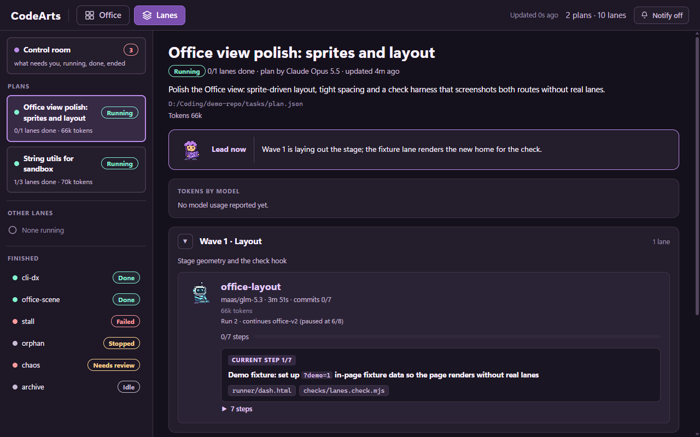

# CodeArts lanes

**Hand coding work to the Huawei CodeArts agent from the coding agent you already use.**

Your agent (Claude Code, Kiro, Cursor, Codex, opencode, VS Code) plans the work. A CodeArts
**lane** writes the code in your repo, commits each step, runs your tests, fixes what fails
and gets a review. You read one summary and decide.

Runs on Windows, macOS and Linux (Node 20+, git).



## Set it up in one prompt

Open your coding agent and send this:

```text
Set up CodeArts lanes by following
https://raw.githubusercontent.com/Kahar90/codeartsclimcp/main/INSTALL.md
```

That's it. Your agent installs everything, connects itself and runs a short test lane. Setup
is once per machine: every repo works afterwards, nothing to set up per project.

**Your only step:** a browser tab opens and asks for your Huawei Cloud keys. Create an AK/SK at
[CodeArts CLI auth settings](https://codearts.ap-southeast-1.huaweicloud.com/portal/settings/cli-auth),
paste them in and click Save. The keys stay on your computer and never go through the chat.



You need a Huawei Cloud account with CodeArts access. Everything else (Node check, the
CodeArts CLI, git, config) the agent handles.

## Use it

Restart your coding agent once after setup, then, in any repo, ask for what you want built:

| Your agent | Type |
|---|---|
| Claude Code | `/codearts-build add a /health endpoint with a test` |
| Kiro | `#codearts-lanes add a /health endpoint with a test` |
| Cursor, Codex, opencode, VS Code | `Use CodeArts lanes to add a /health endpoint with a test` |

A folder that is not a git repo yet is fine: your agent makes it one before the first lane.

Your agent splits the goal into small steps, starts one or more lanes, waits, checks the
result and reports back with what was built, the commits and the review verdict.

## Watch it work

Open **http://127.0.0.1:4777** while lanes run. The Office view (above) shows who is working on
what, step by step; the Lanes view has the plan, every lane's progress, the transcript and a
box to steer a lane mid-run.

Every plan and lane also shows how long the work took. Hover, focus or tap the **Time** chip on
a plan (Lanes) or in the Office runstrip to open the breakdown: lead planning, lanes running,
lead between lanes and lead verifying, plus worker time per phase and per lane.



## Controls and tokens

From the dashboard, or with `ca kick` and `ca resume`, anyone watching can act on a lane without
the lead: **kick** a stuck turn (retry the turn, start a fresh session, restart the CodeArts
server or skip a backoff wait), and **resume** a paused, failed, stopped or DEAD lane where it
left off, with an optional note the worker applies first. **Mark handled** (`ca ack`) moves a
failed or paused lane you already dealt with out of Needs you. Every view also shows what the
lane spent: token totals per agent (builder, reviewer, other sessions) and per model (lead
included when its harness reports it), per lane and summed per plan.

The **Control room** (the Lanes home) groups every lane from every project into Needs you,
Running, Done and Ended, with the reason, how long ago it happened, a one-click fix, project
filters, a freshness label, the count in the tab title and optional browser notifications.
Nothing leaves Needs you by itself: every row has its own decision (Resume, Kick, Mark handled),
and lanes that have waited more than 2 days collect in an **Older than 2 days** group with one
**Mark all handled** button (`ca ack --stale` from a terminal). Reopen brings a lane back.

## Why it is safe to leave running

- **Checked, not trusted:** your test commands are run by the runner itself when the agent
  says it is done. Failures go back to the agent (up to 3 rounds), and uncommitted work is
  never reported as done.
- **Never silently stuck:** a watchdog tells running from stuck, resumes stalled sessions and
  backs off when the model service has problems. Rate limits, network drops and a sleeping
  laptop are waited out; a lane that shows `rate limited`, `offline` or `queued` continues by itself.
- **Clear when something is wrong:** a rejected key ends the lane in seconds and names the key
  to fix (`ca auth --force`).
- **Reviewed:** a separate read-only reviewer reads every lane's work before you see it.
- **You stay in control:** starting, steering and stopping lanes ask for your approval;
  everything is a normal git commit you can inspect or revert.

## Keep it current

- `ca --version` shows what you have; `ca update` installs the latest and refreshes your
  agent's config; `ca doctor` checks everything (each problem comes with the command that fixes it).
- When a newer release is out, commands like `ca status` print a one-line notice on stderr, the
  dashboard shows an update pill, and `ca doctor` warns; `ca update --check` prints the version and
  what is new, and `ca update` installs it (restart your agent and any open dashboard after).
  Set `CA_NO_UPDATE_CHECK=1` to turn the check off (no notice, no network).
- `ca uninstall` removes exactly what setup added to your agents' config and nothing else
  (`--keys` also deletes your saved keys). See the [changelog](CHANGELOG.md).

## Privacy

Your code and task briefs are sent to Huawei Cloud models. Your keys stay on your computer (on
Windows encrypted for your user, elsewhere in a file only your user can read) and are never
written to the repo or shown to the agent.

## More

- [Manual setup](docs/manual-setup.md): run the setup commands yourself (or for CI).
- [Reference](docs/reference.md): every command, exit codes, lane health, models,
  troubleshooting.
- [Lead workflow](docs/workflow.md): how the agent plans, briefs and verifies lanes.
- [Real-client checklist](docs/client-checklist.md): the 10-minute manual test for Kiro, Cursor
  and VS Code.
- [AGENTS.md](AGENTS.md) and [INSTALL.md](INSTALL.md): instructions written for coding agents.

Contributing: `npm run check` runs every contract check in `checks/` (fake lanes, no paid model
calls; the Office checks need Chrome). Node ESM, no dependencies.
