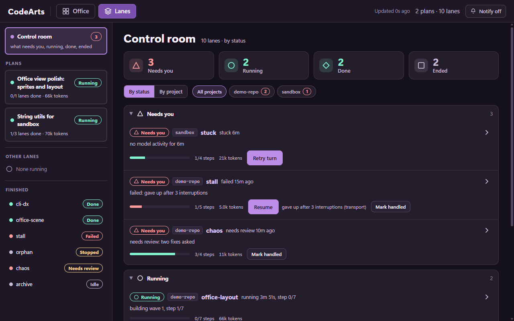
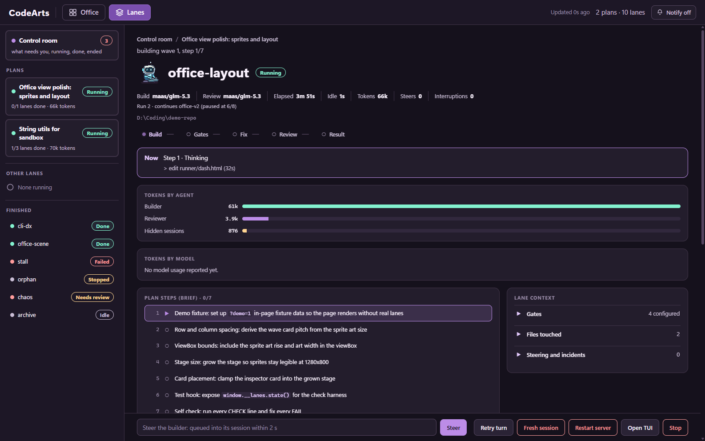

# CodeArts lanes


*The Office view, running on built-in demo data. Follow the lead, builder and reviewer as lanes work.*

**Hand coding work to the Huawei CodeArts agent from the coding agent you already use.**

Your agent (Claude Code, Kiro, Cursor, Codex, opencode, VS Code) plans the work. A CodeArts
**lane** writes the code in your repo, commits each step, runs your tests, fixes what fails and
gets a review. You read one summary and decide.

[Quick install](#quick-install) · [Use it](#use-it) · [Visual tour](#visual-tour) · [Reference](#reference)

## Quick install

Open your coding agent and send this one prompt:

```text
Set up CodeArts lanes by following
https://raw.githubusercontent.com/Kahar90/codeartsclimcp/main/INSTALL.md
```

Your agent installs everything, connects itself and runs a short test lane. Setup is once per
machine: every repo works afterwards, nothing to set up per project.

You need Node 20+, git, and a Huawei Cloud account with CodeArts access. The agent handles the
rest (the CodeArts CLI, config, trust). Everything runs on Windows, macOS and Linux.

**Your only step:** a browser tab opens and asks for your Huawei Cloud keys. Create an AK/SK at
[CodeArts CLI auth settings](https://codearts.ap-southeast-1.huaweicloud.com/portal/settings/cli-auth),
paste them in and click Save. The keys stay on your computer and never go through the chat.


## Use it

Restart your coding agent once after setup, then, in any repo, ask for what you want built:

| Your agent | Type |
|---|---|
| Claude Code | `/codearts-build add a /health endpoint with a test` |
| Kiro | `#codearts-lanes add a /health endpoint with a test` |
| Cursor, Codex, opencode, VS Code | `Use CodeArts lanes to add a /health endpoint with a test` |

A folder that is not a git repo yet is fine: your agent makes it one before the first lane.
Your agent splits the goal into small steps, starts lanes, waits, checks the result and reports
back with what was built, the commits and the review verdict.

## Visual tour

Every screenshot below is the dashboard running on its **built-in demo data** (the `?demo=1`
fixtures), so no real project appears. Open **http://127.0.0.1:4777** while lanes run to watch
your own.

### Control room: what needs you, first



The Lanes home gathers every lane from every project into **Needs you**, **Running**, **Done**
and **Ended**, with the reason, how long ago it happened and a one-click fix. Nothing leaves
Needs you by itself: every row has its own decision (Resume, Kick, Mark handled).

### Plan and waves: watch a goal split into steps


A plan shows each wave of lanes, the current step of every lane and the decisions the agent
recorded, so you can follow a goal from brief to done.

### Lane detail: transcript, brief, steering and checks



Open any lane for its live transcript, the brief it is following, a box to steer it mid-run, and
the checks the runner ran before reporting done.

## Reference

### Why it is safe to leave running

- **Checked, not trusted:** your test commands are run by the runner itself when the agent
  says it is done. Failures go back to the agent (up to 3 rounds), and uncommitted work is
  never reported as done.
- **Honest about checks:** a finished lane that could not run its checks reads `unverified`
  (exit 4), one whose checks still fail reads `checks failing` (exit 1); only a real breakdown
  reads `failed`.
- **Never silently stuck:** a watchdog tells running from stuck, resumes stalled sessions and
  backs off when the model service has problems. Rate limits, network drops and a sleeping
  laptop are waited out; a lane that shows `rate limited`, `offline` or `queued` continues by itself.
- **Clear when something is wrong:** a rejected key ends the lane in seconds and names the key
  to fix (`ca auth --force`).
- **Reviewed:** a separate read-only reviewer reads every lane's work before you see it.
- **You stay in control:** starting, steering and stopping lanes ask for your approval;
  everything is a normal git commit you can inspect or revert.

### Controls and tokens

Anyone watching can act on a lane without the lead: **kick** a stuck turn (`ca kick`), **resume**
a paused, failed, stopped or DEAD lane (`ca resume`) with an optional note it applies first, and
**mark handled** (`ca ack`) to move a dealt-with lane out of Needs you. Every view also shows
tokens spent per agent and model, per lane and summed per plan.

### Keep it current

- `ca --version` shows what you have; `ca update` installs the latest and refreshes your
  agent's config; `ca doctor` checks everything (each problem comes with the command that fixes it).
- When a newer release is out, commands like `ca status` print a one-line notice on stderr, the
  dashboard shows an update pill, and `ca doctor` warns; `ca update --check` prints the version and
  what is new, and `ca update` installs it (restart your agent and any open dashboard after).
  Set `CA_NO_UPDATE_CHECK=1` to turn the check off (no notice, no network).
- `ca uninstall` removes exactly what setup added to your agents' config and nothing else
  (`--keys` also deletes your saved keys). See the [changelog](CHANGELOG.md).

### Privacy

Your code and task briefs are sent to Huawei Cloud models. Your keys stay on your computer (on
Windows encrypted for your user, elsewhere in a file only your user can read) and are never
written to the repo or shown to the agent.

### More

- [Manual setup](docs/manual-setup.md): run the setup commands yourself (or for CI).
- [Reference](docs/reference.md): every command, exit codes, lane health, models,
  troubleshooting.
- [Lead workflow](docs/workflow.md): how the agent plans, briefs and verifies lanes.
- [Real-client checklist](docs/client-checklist.md): the 10-minute manual test for Kiro, Cursor
  and VS Code.
- [Screenshot sources](docs/images/README.md): how the images above were captured.
- [AGENTS.md](AGENTS.md) and [INSTALL.md](INSTALL.md): instructions written for coding agents.

Contributing: `npm run check` runs every contract check in `checks/` (fake lanes, no paid model
calls; the Office checks need Chrome). Node ESM, no dependencies.
